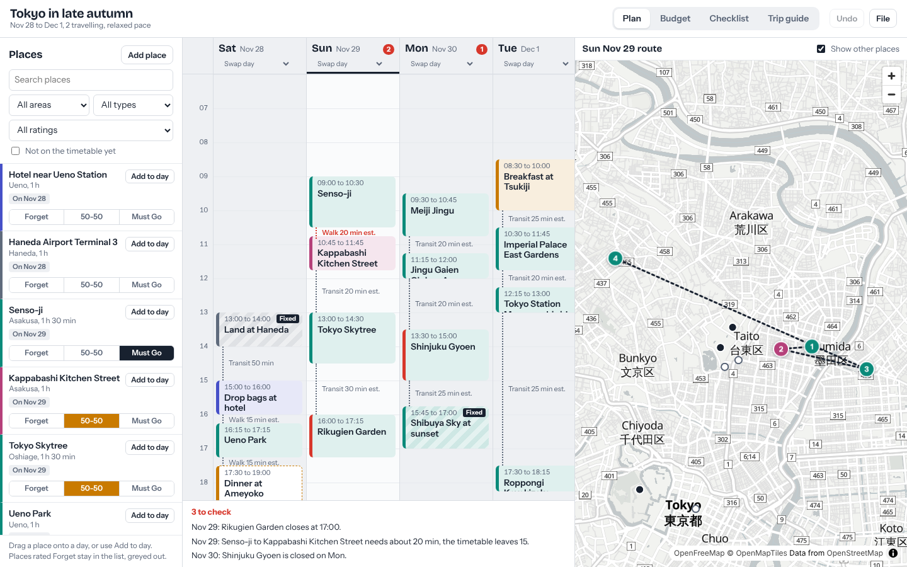
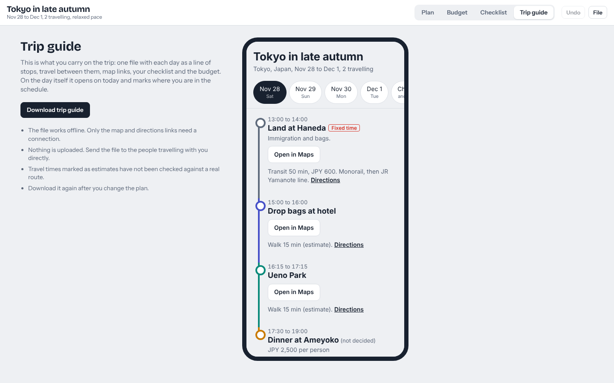

# Wanderlust

A travel planner in two halves:

1. **Plan** on a big screen: a pool of places you have collected, a timetable that works like a class schedule, and a map, all linked.
2. **Travel** with a trip guide: one phone-friendly file with each day as a line of stops, the travel between them, map links, your checklist and the budget.





This is prototype v0. Its interface is being redesigned: three layout options are in [docs/design](docs/design) (view them on the Claude Design canvas linked from [CLAUDE.md](CLAUDE.md)). Start with [CLAUDE.md](CLAUDE.md), then [docs/ux-workflow.md](docs/ux-workflow.md).

## Run it

```bash
npm install
```

```bash
npm run dev
```

Other commands: `npm test` (unit tests), `npm run build` (static site in `dist/`), `npm run lint`.

## What works today

| Area | Status |
| --- | --- |
| Place pool: search, filter by area and type, add from a Google Maps link or coordinates, rate each place Forget / So-So / Must Go | Built |
| Timetable: drag to move across times and days, drag the bottom edge to resize, drop a place onto a day, fixed blocks, undecided blocks, swap two days, undo | Built |
| Checks: overlaps, closed days, opening hours, connections that are too tight | Built |
| Travel between stops | Estimated from straight-line distance and pace, always labelled as an estimate. You can replace it with numbers you checked. No routing provider yet. |
| Map: grey base with railways, numbered day route, other places as dots, selection linked both ways | Built (needs a connection for tiles) |
| Budget: cost per person per block, fares, party total, home-currency conversion | Built |
| Pre-trip checklist | Built |
| Trip guide: preview and download as one offline HTML file | Built |
| Save and open a trip as a `.trip.json` file; autosave in the browser | Built |

Not built yet: real routing and fares, importing from social posts, lodging and car-hire comparison, pass calculator, order suggestions, sharing and collaboration, desktop packaging. See [docs/decisions.md](docs/decisions.md).

## Where things are

```
src/types.ts              The trip data model
src/lib/schedule.ts       Travel estimates, checks, budget, day swap (pure functions, tested)
src/lib/guide.ts          Builds the standalone trip guide HTML
src/store.tsx             Trip state, undo, browser autosave
src/components/           Place pool, timetable, map, detail panel, other views
src/sample.ts             A made-up sample trip (placeholder data, not verified)
docs/                     Workflow, requirements, decisions and roadmap
```

## Privacy

Trips are stored in your browser and in files you save yourself. Nothing is sent to a server. The sample trip is invented. Do not commit real trip files to this repository.
