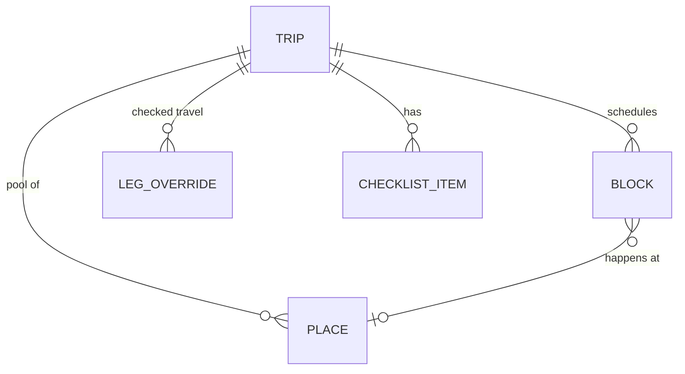

# What we need, working backward from the screens

Each section starts from something the user sees and lists what has to exist underneath it. Status is for prototype v0.

## Data model

Defined in [`src/types.ts`](../src/types.ts). A trip is one JSON document.

| Entity | Key fields | Why the UI needs it |
| --- | --- | --- |
| Trip | name, destination, start and end date, party size, pace, currency, home currency, rate and rate date | Day columns, estimates, budget conversion |
| Place | name, area, type, lat/lng, usual stay, opening hours, closed weekdays, seasonal tag, source link, rating (1 Forget, 2 50-50, 3 Must Go) | Pool filters, map position, default block length, closure checks |
| Block | day, start, end, title, type, place, fixed, undecided, cost per person, notes | The timetable |
| Leg override | mode, minutes, fare, notes, keyed by the two blocks it joins | Checked travel replaces the estimate |
| Checklist item | text, note, done | Pre-trip list |

Design choices:

- **Travel is derived, not stored.** The spreadsheet had travel rows that had to be re-typed after every change. Here, travel is computed between each pair of consecutive stops, so moving a block never leaves a stale travel row. Only numbers the user confirmed are stored.
- **A block is separate from a place.** A place can be visited twice, and a block (a flight, free time) may have no place.
- **Still missing from the model:** lodging candidates with per-platform prices and cancellation deadlines; transfer quotes; passes and whether a leg is covered; budget targets per category; multiple trips. Named travellers with their own ratings were removed on 2026-11-17 to keep the first version simple.

## Per screen

### Place pool

| Need | Status | To get there |
| --- | --- | --- |
| Add by hand with a position | Built | |
| Position from a pasted Google Maps link | Built for full links containing coordinates | Short links (`maps.app.goo.gl`) need a network lookup |
| Auto-fill name, address, hours from a link or search | Not built | A places provider (Google Places, or OpenStreetMap via Nominatim/Overpass). Needs an API key or a small server |
| Import from Threads, Instagram, Facebook posts | Not built | These sites block scraping. Realistic route: share the post to an assistant that extracts the place, then confirm it in the app |
| Rate each place Forget / 50-50 / Must Go | Built | Forget greys the place out rather than deleting it |
| Suggested nearby places | Not built | Places provider |

### Timetable

| Need | Status | To get there |
| --- | --- | --- |
| Drag, resize, drop from pool, fixed, undecided, swap days, undo | Built | Touch dragging on tablets is untested |
| Overlap, closed-day, opening-hours, tight-connection checks | Built | Hours are one open/close pair per place; real hours vary by weekday and season |
| Travel time between stops | Estimate only | Routing provider behind one function (`estimateLeg`) |
| Suggest a better order for a day | Not built | Needs real travel times first; then a small search over orders that respects fixed blocks and hours |
| Merge detail into one block | Partly: notes field | Sub-items if notes prove too weak |
| Export back to spreadsheet columns | Not built | CSV export is straightforward |

### Map

| Need | Status | To get there |
| --- | --- | --- |
| Grey base map with railways | Built on OpenFreeMap tiles (free, no key) | Check their usage terms before a public launch; self-host tiles or pay a provider if traffic grows |
| Day route, pool dots, linked selection | Built | Route is straight lines; real paths need routing |
| Lodging candidates as a layer | Not built | Lodging model |
| Works offline on desktop | No | Bundled regional tiles (PMTiles) |

### Travel and fares

This is the largest unknown and decides most of the cost.

| Option | Gives | Concern |
| --- | --- | --- |
| Manual check via Google Maps link (today) | Correct numbers, zero cost | Slow: one click and a few fields per connection |
| Google Routes API | Walking and driving times worldwide; transit in most countries | **No transit in Japan**: Google's FAQ says the Routes API excludes Japanese transit partners (checked 2026-11-17). Pricing: 10,000 free requests a month for basic routes, then about USD 5 per 1,000 |
| Open routing (OSRM, Valhalla, OpenTripPlanner) | Walking and driving for free; transit only where GTFS feeds exist | Japanese rail GTFS coverage is partial; fares mostly absent |
| Japan-specific transit APIs (e.g. Navitime, Ekispert) | Good Japan transit and fares | Paid, Japan only |

Recommendation: keep the manual check as the baseline (the Google Maps website and app do show Japanese transit, so the "Check route" link works), add walking times from Google Routes or an open router, and use a Japan-specific provider only if automatic train times in Japan prove worth paying for.

Sources: [Google Maps Platform pricing](https://developers.google.com/maps/billing-and-pricing/pricing), [Google Maps Platform FAQ](https://developers.google.com/maps/faq), [Routes API coverage](https://developers.google.com/maps/documentation/routes/coverage).

### Budget

Built: per-block cost, fares, totals by type and day, conversion with a dated manual rate. Missing: budget targets to compare against, costs that are per group rather than per person (a hired car), automatic exchange rate.

### Trip guide

| Need | Status | To get there |
| --- | --- | --- |
| One offline file, opens on today, now and next, map and directions links, checklist ticks | Built | |
| Re-sync after the plan changes | Manual: download again | Private hosted link that always shows the latest plan (needs Sync) |
| Install on the phone home screen | Not built | Make it a PWA once it is hosted |
| Offline map of each day | Not built | Static map image per day, or bundled tiles |
| Tickets, booking references, addresses in the local language | Not built | Fields on blocks; attachments |

### Storage and sync

| Need | Status | To get there |
| --- | --- | --- |
| Keep the trip between visits | Built: browser storage, plus save/open as a file | |
| More than one trip | Not built | A trip list; IndexedDB |
| Same trip on several devices; other people editing | Not built | An account and a backend, or a file-based share. Biggest architectural step; postpone until the single-user flow is right |

## Platform

One codebase: React, TypeScript, Vite. It builds to static files.

- **Website:** deploy `dist/` to any static host.
- **Desktop:** wrap the same build in Tauri (small, uses the system web view) or Electron. Asset paths are already relative so the build runs from a local file path. Not packaged yet.
- **Trip guide:** intentionally independent of the app, so it keeps working whatever happens to the planner.
