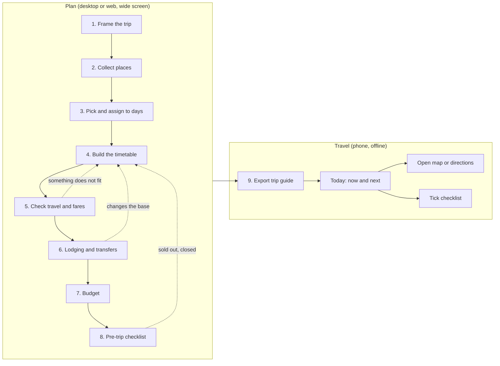

# User workflow

The source for this is Brady's write-up of how a real family trip was planned with a spreadsheet, chat and Google Maps (the Claude doc "旅遊規劃 App：Brady 的規劃流程與需求"). That process had ten steps and kept looping back to the timetable. This document turns it into the app's workflow, then names the screens. [requirements.md](requirements.md) works backward from the screens to what must exist.

## Who it is for

The general public, planning a multi-day trip for a small group. The first scenario is one organiser planning for family, including elders. Planning happens at a desk on a wide screen. The trip itself happens on a phone, often with poor signal, often one-handed.

## The two modes



The dotted arrows are the important part. Every later step can send you back to the timetable, so the timetable has to be cheap to change: drag, swap, undo, and immediate feedback on what broke.

## Steps, and what the app does at each

| # | Step | What the user does | What the app does | v0 |
| --- | --- | --- | --- | --- |
| 1 | Frame the trip | Names the trip, sets dates, who is going, and a pace | Creates the empty days. Pace sets walking speed and how tight connections may be | Built (Trip settings) |
| 2 | Collect places | Saves ideas over weeks, from posts, links or by hand. Not all will be used | Keeps a pool. Fills in position, hours and usual stay | Manual add with a Maps link or coordinates. No auto-fill yet |
| 3 | Pick and assign | Each traveller marks want / maybe / skip. Filters by area. Seasonal items go first | Shows who wants what, what is already scheduled, and where everything is on the map | Built |
| 4 | Build the timetable | Drags places onto days, moves and resizes blocks, marks fixed ones (flights, sunset, timed tickets) | Inserts travel between consecutive stops. Flags overlaps, closures, tight connections | Built |
| 5 | Check travel and fares | For each connection, confirms route, time and fare | Opens the exact route in Google Maps. Stores the confirmed numbers and stops calling it an estimate | Built as a manual check. No routing provider |
| 6 | Lodging and transfers | Compares candidates on total price, walk to station, cancellation | Comparison table and candidates on the map | Not built |
| 7 | Budget | Enters cost per person on blocks | Multiplies by party size, converts to home currency, totals by type and day | Built |
| 8 | Checklist | Lists what to ask, book and decide | Tracks done and open | Built |
| 9 | Export | Downloads the trip guide and sends it to the group | Builds one offline file from the plan | Built |
| 10 | Travel | Opens the guide each day | Opens on today, shows now and next, links to maps and directions | Built |

## Screens

### Plan

Three panes, side by side, selection linked across all of them. On a narrow screen they become three tabs.

```
+----------------+-----------------------------+----------------------+
| Places         | Timetable                   | Map                  |
|                | Sat   Sun   Mon   Tue       |                      |
| search, filter | 09 [Senso-ji]               |   (1)---(2)          |
| [Senso-ji  Y P]|    : walk 20 est.           |        \             |
| [Skytree   Y P]| 11 [Kappabashi]             |        (3)   o  o    |
| [Museum    Y P]|    : transit 20 est.        |                      |
|   drag  ---------> [Skytree]                 +----------------------+
|                |                             | Details of selection |
|                | 3 to check: ...             | title, time, cost... |
+----------------+-----------------------------+----------------------+
```

- **Places** answers "what could we do?". A place is a candidate, not a commitment.
- **Timetable** answers "what are we doing, and does it fit?". Columns are days, rows are time. A block is a stay. Travel is drawn in the gaps and is derived, never dragged.
- **Map** answers "does the order make sense?". It shows the selected day as numbered stops joined in order; everything else in the pool is a small dot, so nearby candidates are visible.
- **Details** opens under the map for whatever is selected: a block, a place, or a connection.

Rules that keep it trustworthy:

- Anything the app guessed says so ("est."). It stops saying so only when the user enters checked numbers.
- Fixed blocks cannot be dragged. Swapping whole days moves them too, after a confirmation.
- Problems are listed in words under the timetable, and each one jumps to its block.
- Every change can be undone.

### Budget, Checklist

Plain pages. Budget is read-only and computed from the timetable, so there is one place to enter a cost.

### Trip guide

The output of planning. A vertical line of stops per day, coloured by type, like a line diagram of a train route:

- Day tabs across the top; opens on today during the trip.
- A yellow "now / next" card on the current day; past stops fade.
- Each stop: time, title, fixed or undecided marker, notes, cost, "Open in Maps".
- Between stops: how to get there, how long, fare, whether it is an estimate, and a "Directions" link.
- A last tab with the checklist (ticks are remembered on the phone) and the budget total.

It is one HTML file with no dependencies. It can be opened from Files, sent by AirDrop or a messaging app, or hosted behind a private link later.

## What v0 deliberately leaves rough

- Travel time is a straight-line guess. It is good enough to see the shape of a day and bad enough that it must be checked.
- Adding a place needs coordinates. This is the biggest friction in step 2.
- One trip at a time, on one device.
